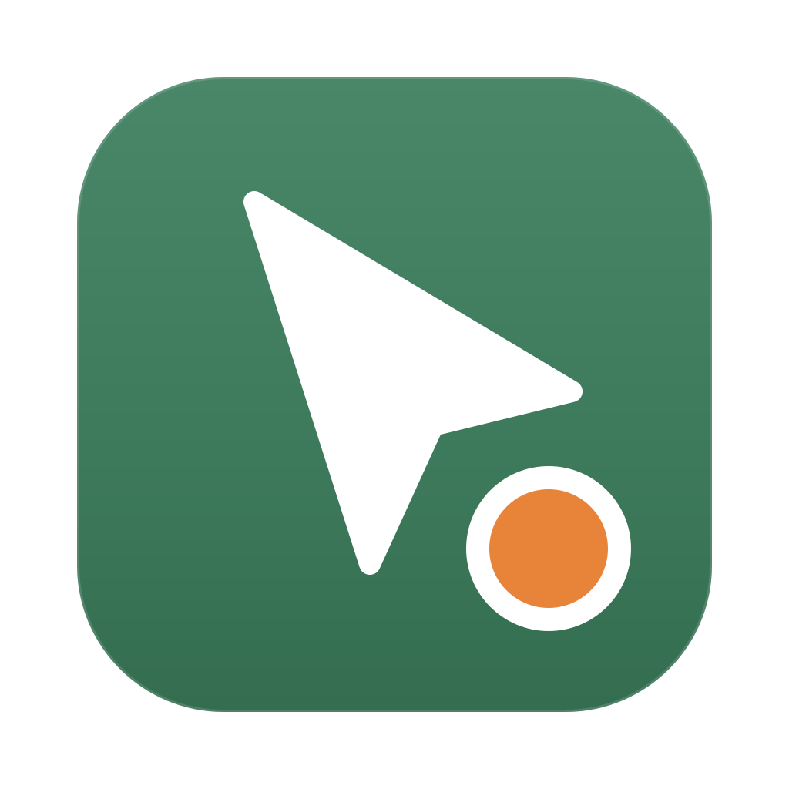
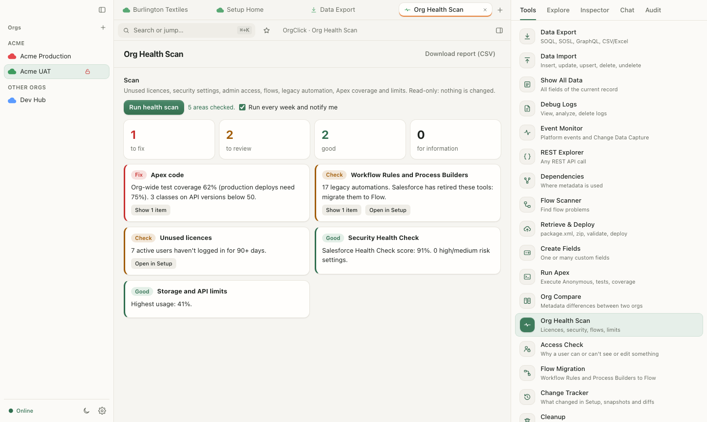

# OrgClick

### Every Salesforce org, in one focused workspace.

A desktop app for Salesforce admins and developers. Work in production and every sandbox side by side, query and move data, read metadata and debug faster, with an AI assistant that shows its work and asks before it changes anything.

**[Website](https://orgclick.com) · [Download](https://orgclick.com/#download) · [Pricing](https://orgclick.com/pricing) · [Contact](https://orgclick.com/contact)**

 

---

## Download

Get the installer for your computer from **[orgclick.com/#download](https://orgclick.com/#download)** or from the
[Releases](../../releases) page of this repository. Windows 10/11 (64-bit), macOS (Apple Silicon and Intel) and Linux
(AppImage, .deb).

> The newest published build is **0.2.2**, released before the product was renamed: its files and the app itself are
> still called *OrgPilot*. The first build under the OrgClick name will replace it here.

**First launch: your computer may warn you**

- **macOS:** the app isn't notarized by Apple yet. Open it once, then go to **System Settings → Privacy & Security** and
  click **Open Anyway**. If macOS says the app is "damaged", run
  `xattr -dr com.apple.quarantine /Applications/OrgClick.app` in Terminal.
- **Windows:** if SmartScreen says "Windows protected your PC", click **More info → Run anyway**.
- **Linux AppImage:** make it executable (`chmod +x` on the file) and run it.

## What you can do

**Work across orgs**
- Every org in one window, each in its own isolated session and colour, so production never gets mixed up with a sandbox.
- Command palette (Ctrl/Cmd + K) to jump to any Setup page, object, flow, profile, permission set, Apex class, user or record.
- Favourites across orgs, split view to compare two orgs side by side, and your tabs restored where you left off.

**Data**
- **Data Export:** SOQL, SOSL and GraphQL with field autocomplete, query tabs, history, list-view queries, query plans, CSV and Excel export.
- **Data Import:** paste from Excel or load CSV and JSON; insert, update, upsert, delete and undelete in batches, with undo.
- **Show All Data:** every field of a record with API names and types; edit inline, check field usage, explain formulas.

**Build and debug**
- Debug logs and platform events, Run Apex and tests with coverage, metadata tools (dependencies, flow scanner, retrieve and deploy), REST Explorer and user tools.

**Org health and change**
- Org Compare, Org Health Scan and Setup Audit Trail across your orgs.

**AI assistant (Pro and Enterprise)**
- Ask in plain English: it writes and runs queries, reads logs and metadata, and opens records and pages for you.
- Ask mode confirms every change; Auto mode makes sandbox changes on its own, and production always asks.
- Runs on your GitHub Copilot plan (Copilot Free works), your own API key, or a local model with Ollama. We never charge for AI use.

## Plans

| | Free | Pro | Enterprise |
|---|---|---|---|
| Orgs | 3 | Unlimited | Unlimited |
| Data Export / Import | 2,000 / 200 rows | No limits | No limits |
| Deploy, Create Fields, Org Compare | Validate only | ✓ | ✓ |
| AI assistant | | ✓ | ✓ |
| Admin website (users, licences, policies, one bill) | | | ✓ |

Pro has a 14-day trial with no card needed. Current prices: **[orgclick.com/pricing](https://orgclick.com/pricing)**.

## Security and privacy

- OrgClick runs on your computer. Your Salesforce data travels only between your computer and Salesforce (and, when you use the AI, the provider you chose). We never receive it.
- Salesforce tokens and AI keys are encrypted with your operating system's keychain. Your password is only ever typed into Salesforce's own login page.
- Every change shows old and new values before it runs, is logged, and can be undone.
- No analytics or tracking. Details: [Privacy Policy](https://orgclick.com/privacy) · [Terms of Use](https://orgclick.com/terms).

## Support

Questions, sales or a problem: **[orgclick.com/contact](https://orgclick.com/contact)**.
Ideas and bug reports: **[orgclick.com/feedback](https://orgclick.com/feedback)**.

---

OrgClick is an independent tool and is not affiliated with, endorsed or sponsored by Salesforce, Inc. Salesforce is a trademark of Salesforce, Inc. Third-party components: [THIRD_PARTY_NOTICES.md](THIRD_PARTY_NOTICES.md).
